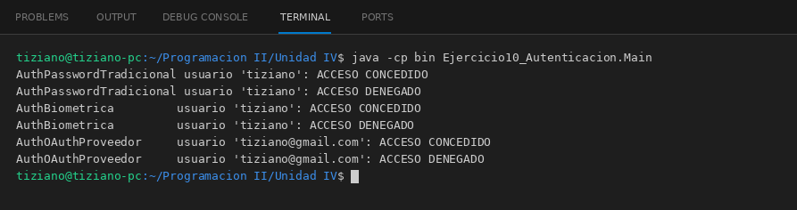

# MecanismoAutenticacion

Programación II - Unidad 4 - Ejercicio 10

## Consigna
Validar el inicio de sesión con contraseña, biometría y proveedores OAuth a través de un contrato común.

## Lógica
- Interfaz `MecanismoAutenticacion` con `boolean validarIdentidad(String identificador, String credencial)`.
- `AuthPasswordTradicional` guarda solo el hash de la contraseña, `AuthBiometrica` compara la huella con un mínimo de 90 % de coincidencia y `AuthOAuthProveedor` acepta tokens de proveedores confiables con el formato esperado.
- `ControladorAcceso.iniciarSesion(...)` recibe cualquier mecanismo y concede o deniega el acceso.
- `Main`: intentos correctos e incorrectos con cada mecanismo.

## Ejecución

